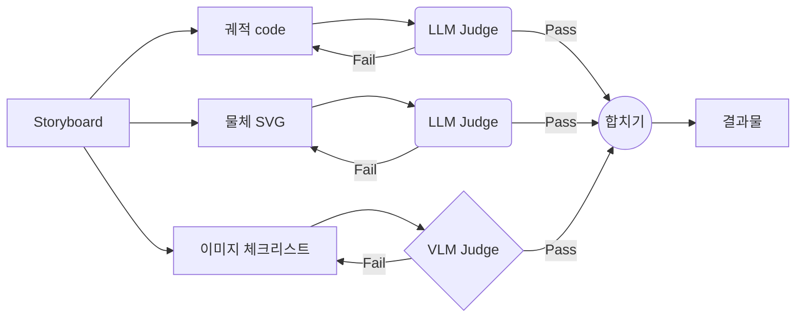

# Learn to Tell

> coding agent가 작업 중 "이 결정을 하려면 사용자가 무엇을 알아야 하는가"를 찾아내고, 그 결정에 필요한 기본기를 **infographic animation 수업**으로 익히게 한 뒤 원래 작업으로 돌려보내는 Claude Code skill.

- 예시 수업 갤러리: https://learn-to-tell.vercel.app
- 회고 글: [LLM Judge, 나를 대신해줄 LLM을 찾아서](https://doggy-portfolio.vercel.app/posts/llm-judge-fail)
- 상태: 2026-10, 생성된 animation을 검사하는 **LLM Judge 단계에서 개발을 멈췄다.** 이 README는 그 LLM Judge를 만들려다 실패한 과정과 근거를 중심으로 정리한다.

## 요약

- **하려던 것**: agent가 만든 infographic animation 장면을 LLM Judge가 검사하고, 한 번 고친 뒤 사용자에게 보여 준다.
- **처음 부딪힌 벽**: 정지 스크린샷으로는 **시간**을 볼 수 없다. Opus 채점관은 사람 점수와 Spearman 0.39–0.45에 그쳤고, VLM은 시간 순서대로 준 스크린샷과 역순으로 준 스크린샷도 구분하지 못했다.
- **우회책**: 움직임은 LLM 대신 **코드로 측정**했다(50ms마다 요소 위치·크기 기록, 결함 주입, 통과 기준 사전 등록). 흔들림·그림이 작음·애니메이션 없음은 잡았고, 순간이동·속도는 못 잡았고, 끊김은 오탐이 너무 많았다.
- **마지막 시도**: 사용자 라벨 40칸(20개 항목)을 만들고 Sonnet judge 프롬프트를 v1→v4로 고쳤다. "원리를 보여 주는 애니메이션이 있는가"에서는 사용자와의 일치가 11 → 11 → 10 → 8 / 19로 오히려 떨어졌다.
- **결론**: Judge를 최종 결과물 하나에 붙이는 평가 도구가 아니라 **아키텍처의 한 부품**으로 설계해야 했다. 그리고 **의도(스토리보드)가 명확하지 않은 테스트 셋**으로는 judge를 맞출 수 없었다.

---

## 1. 배경: 왜 LLM Judge가 필요했나

Learn to Tell은 사용자가 모르는 결정 변수를 진단한 뒤, 이해에 필요한 개념을 **움직이는 그림(infographic animation)** 으로 보여 준다. 수업은 agent가 그 자리에서 생성한다. 생성물은 틀리거나 보기 어렵기 쉽다. 그림이 첫 화면 밖에 있거나, 프레임이 흔들리거나, 노드가 이동 경로 없이 새 자리에 나타나거나, 결과만 보이고 원리는 안 보이는 식이다.

사람이 모든 장면을 볼 수는 없다. 사용자 본인이 블라인드로 18묶음 × 6장면을 채점하려 했지만 13묶음(78장면)에서 멈췄다. 시간이 너무 들었고, 채점하는 동안 피로와 익숙함 때문에 기준이 바뀌었다. 그래서 **사람(전문가·사용자)을 대신하는 평가자**, LLM Judge가 필요했다.

> LLM Judge는 주식의 레버리지와 같다. 잘 쓰면 golden set 같은 적은 노력을 프로덕션 전체로 넓힐 수 있지만, 잘못 쓰면 틀린 결과가 "LLM Judge approved" 마크를 달고 신뢰받는다. (회고 글)

## 2. 시도와 실패

| # | 시도 | 결과 | 원인 |
| --- | --- | --- | --- |
| 1 | Opus 채점관: 정지 스크린샷 + 장면 HTML로 묶음 비교 1–10점 | 사용자와 Spearman 0.39–0.45. 갈래 순위가 사용자와 다름(사용자 1위 갈래가 채점관에서는 하위). 자기 재현성은 0.86 | 일관되게 다른 것을 봤다. 채점관은 빠짐없음·사실 정확성을 보고, 사용자는 움직임의 연속성·안정성·크기·첫 화면 배치를 본다. 정지 화면에는 움직임이 없다 (가설) |
| 2 | 사용자 블라인드 채점 | 108장면 중 78장면에서 중단 | 부담·피로·익숙함으로 기준이 흔들림 |
| 3 | 외부 문헌으로 기준표 만들기: 출처 43개, 인용 3,764개 수집 → 여러 회사 모델 4개가 서로 보지 않고 초안 작성 → 병합(73개 항목) → 비판 반영 | 비판 반영 규칙 "비판 모델 2개 이상이 같은 방향"에서, 바뀐 기준값 17개 중 7개가 OpenAI 모델 둘의 지적만으로 바뀜 | 같은 회사 모델 두 개가 독립된 두 표로 세어졌다. 다회사 합의를 구성 원칙에서 뺐다 |
| 4 | 문헌 인용 → 이진 항목 번역을 LLM에 맡기고, 사용자 충실도 판정과 LLM 판정자의 일치로 검증 | 사용자가 충실하다고 본 비율 43% → (프롬프트 수정 후) 48%. 판정자–사용자 kappa 0.36–0.48 → 0.11–0.22 | 번역 모델이 인용 일부를 빼거나 조건을 넓혔다. 사용자도 논문 수준 채점표를 판단할 기초 지식이 부족했다 |
| 5 | 결정론적 측정: 브라우저에서 장면을 실행하며 요소 위치·크기를 50ms마다 기록하고 코드로 판정 | 흔들림·작음·애니메이션 없음·화면 밖 변화는 통과. 순간이동·속도는 탈락. 끊김은 규칙상 통과했지만 라벨 없는 장면 오탐 34/79 | 아래 2.2 |
| 6 | 사용자 라벨 40칸 + Sonnet judge(화면 캡처 + 움직임 사건 목록 + 측정값) v1–v4 | 형식 항목은 대체로 일치. "원리를 보여 주는 애니메이션" 항목은 프롬프트를 고칠수록 일치가 떨어짐 | 아래 2.3 |

### 2.1 VLM은 시간을 보지 못한다

LLM에게 이미지를 무제한으로 줄 수는 없으니 스크린샷은 일정 간격으로 찍는다. 그러면 LLM은 시간을 알 수 없다. A → B 이동이 진동하며 간 것인지, A → C → B로 다른 곳을 거친 것인지, 순간이동한 것인지 구분하지 못한다. VLM은 시간 순서대로 준 스크린샷과 역순으로 준 스크린샷도 구분하지 못했고, 50ms 단위 스크린샷을 줘도 움직임의 방향을 전혀 알아보지 못했다. 처음에는 토큰 비용 정도를 걱정했지만, 진짜 문제는 비용이 아니었다.

조사한 연구도 같은 방향이었다(조사 노트 기준, 원문은 다시 확인하지 않음).

- VLM judge는 시간 축 손상(프레임 섞기·멈춤·역재생)에 둔감했다.
- Manim 교육 영상 judge와 사람의 상관: 시각 관련성 0.72, 배치 0.42, 시각 일관성 0.17 (TheoremExplainAgent, ACL 2025).
- MotionBench 최고 VLM 점수 0.58.

ArtifactsBench, ManimAgent, Code2Video, LiveSVG 같은 관련 프로젝트도 아키텍처에 믿고 넣을 수 있는 animation judge를 만들지는 못했다.

### 2.2 움직임은 코드로 측정한다: 결함 주입과 사전 등록

픽셀 대신 구조화된 데이터로 시간을 보기로 했다. 장면은 모두 d3(SVG/DOM)였고 `<canvas>`는 0개였다. 그래서 Playwright로 장면을 실행하며 SVG 요소의 상자·불투명도·글자를 50ms마다 기록했다. 학습자 대신 "다음"·예측 선택지를 누르는 드라이버도 만들었다.

**검증 방법**

- **결함 주입**: 사용자가 결함 없다고 본 깨끗한 장면 24개에 결함 6종(흔들림, 끊김, 화면 밖, 작게, 정지, 3배속)을 일부러 넣었다. golden set이 없어도 정답이 생긴다.
- **사전 등록**: 실행 전에 기록에 적었다. 임계값은 깨끗한 장면의 실패가 10% 이하가 되는 가장 엄격한 값으로 정했고, 통과 기준은 주입 탐지율 90% 이상과 사용자 메모 라벨 대비 AUC 0.75 이상이었다.
- **반복 측정**: 252개 실행을 3회(756회, 오류 0) 반복해 중앙값을 썼다. 반복 사이에 판정이 뒤집힌 장면 수도 셌다.
- **통과 기준 밖 보고**: 라벨 없는 채점 장면 전체에 대한 오탐, 묶음 하나 빼고 임계 다시 맞추기(LOBO).

**결과**(`experiments/scene-pipeline/measure/analyze.py`, 3회 중앙값)

| 결함 | 지표 | 주입 탐지 | 라벨 재현 | AUC | 판정 | 라벨 없는 장면 오탐 |
| --- | --- | --- | --- | --- | --- | --- |
| 흔들림 | `frame_jumps` | 1.00 | 8/8 | 0.98 | PASS | 8/75 |
| 그림이 작음 | `svg_area` | 1.00 | 8/8 | 1.00 | PASS | 14/75 |
| 애니메이션 없음 | `smooth_px` | 1.00 | 7/7 | 1.00 | PASS | 13/76 |
| 화면 밖에서 변함 | `hidden_change` | 1.00 | 13/15 | 0.92 | PASS* | 0/68 |
| 이동 없이 다시 생김 | `path_shown` | 0.89 | 2/7 | 0.85 | fail | 7/56 |
| 너무 빠름 | `speed_p90` | 0.38 | 1/3 | 0.92 | fail | 9/80 |
| 선 단위로 툭툭 그려짐 | `isolated_change` | 1.00 | 3/4 | 0.93 | PASS → 사용 불가 | **34/79** |

\* 앞 실행 결과를 보고 사후에 고른 지표를 같은 장면에서 다시 잰 것이라 독립 검증이 아니다. 맞힌 라벨 13개 중 다수가 한 주제였다.

실패에서 나온 사실:

- **"끊김"은 두 가지였다.** 사용자 설명을 듣고 라벨을 나눴다. 대상이 이동 없이 새 위치에 다시 생기는 것은 이해를 방해한다. 선이 툭툭 그려지는 것은 미감 문제다. 하나의 지표로는 둘 다 잡을 수 없다.
- **허용 속도는 움직임 종류마다 다르다.** 날아가는 것만 알아채면 되는 움직임, 읽어야 하는 움직임, 변하는 모습을 관찰해야 하는 움직임이 있다. 절대 속도 임계는 9점 장면(64.0)에도 걸렸다.
- **측정 도구 자체가 결함을 만든다.** 파일럿 3회에서 드라이버 결함 3개를 찾았다(자체 "다음" 버튼이 처음으로 돌아가 144번 클릭, 1.5초 쉼을 끝으로 판정, 움직이는 중 상한에 걸려 종료). 독립 검토 subagent는 드라이버가 자동 재생 장면을 약 8.9초에 끊었다는 것을 찾았다. 드라이버를 고치자 다른 지표의 오탐도 바뀌었다.

### 2.3 사용자 라벨과 Sonnet judge v1–v4

마지막으로, 사람이 보는 것과 같은 자료를 judge에 주고 항목별로 맞춰 보았다.

- **라벨 세트**: 장면 40칸(본보기 shot 카드 30 + 생성 실험 장면 10)에 사용자가 20개 항목을 매겼다. 항목은 첫 화면, 흔들림, 이동 없이 다시 생김, 속도, 원리를 보여 주는 애니메이션, 비교 어려움, 글자 오류 등이다. 라벨을 매기는 동안 항목 정의가 다섯 번 바뀌었고, 바뀔 때마다 앞 칸을 다시 매기거나 처리 방식을 기록했다.
- **분할**: dev 19칸으로만 프롬프트를 고치고, holdout 21칸은 마지막 한 번을 위해 judge에 대 보지 않았다(결국 쓰지 않음).
- **입력**: 장면 의도, 항목 정의, 쪽 도착 화면, 3×3 프레임 묶음, 50ms 측정을 요약한 **움직임 사건 목록**(나타남·사라짐·이동·순간 이동·크기 변화), 측정 지표. `claude -p --model sonnet --effort medium`에 `--json-schema`로 20개 항목의 답과 근거를 받았다(`experiments/scene-pipeline/label_judge.py`).
- **같은 입력 반복**(v1 대 v1b): 19칸 중 답이 같은 칸이 "어디를 볼지 모름" 10, 대부분 항목 16–19. 항목에 따라 judge 자체의 흔들림이 크다.

v1의 어긋남을 나누면 세 종류였다.

| 종류 | 예 |
| --- | --- |
| 입력에 정보가 없음 | 드라이버가 슬라이더를 움직이지 않아 "조작 뒤 다시 진행" 판단 불가. d3가 같은 자리에 다시 그리는 DOM 교체가 사건 목록에 "사라짐·나타남"으로 들어가 "이동 없이 다시 생김" 오탐 7칸. 사건 목록이 글자를 20자로 잘라 "잘린 문장"으로 오판 |
| 기준이 다름 | "원리를 알 수 없음" 사용자 7칸 중 6칸을 judge는 문제 없음으로 봄. "비교 어려움" 사용자 11칸, judge 2칸 |
| 사람이 놓침 | 글자 오류("10를", "72.9을")는 judge가 찾았고 사용자가 놓쳤다. 사용자: "Judge가 더 잘하는 거 같아." |

"원리를 보여 주는 애니메이션" 항목을 **한 번에 하나씩** 고쳤다.

| 판 | 바꾼 것 | 사용자와 일치(dev 19칸) |
| --- | --- | --- |
| v1 | 기준 | 11 |
| v2 | 정의에 "결과(수식·값)가 보이는 것만으로는 안 된다" 추가 | 11 |
| v3 | judge 전용 절차: 근거를 결과/원인으로 나눠 쓰게 함 | 10 |
| v4 | 사용자 설명을 일반화한 절차: 결과의 각 부분이 어느 입력에서 오는가, 한 단계가 다음으로 어떻게 이어지는가 | 8 |

사용자가 "원리를 알 수 없음"으로 본 7칸은 **모든 판에서** judge가 문제 없음으로 봤다. judge는 글과 라벨이 말해 주는 연결("대출금 90이 다른 은행의 새 예금이 된다")을 보인 것으로 셌다. 사용자는 애니메이션이 움직이는 속도 안에서 그림만으로 따라갈 수 있는지를 봤다. judge는 정지 프레임을 시간 제한 없이 읽는다. 사용자의 결론은 이랬다.

> 내가 볼 때는 의도를 명확하게 하지 않은 테스트 셋을 사용한 게 문제야.

shot 카드 49장은 스토리보드 없이 만들어졌다. "원리가 보이는가"는 "무엇을 보여 주려 했는가"가 있어야 판정할 수 있다.

## 3. 실패 원인

1. **animation은 어려운 Judge다.** VLM과 computer-use가 있으니 쉬울 거라 생각했지만 시간 순서조차 판별하지 못했다. 시작하기는 쉬웠지만 완성하기는 어려운 문제였고, 첫 LLM Judge 문제로는 맞지 않았다.
2. **측정·통계 방법론을 몰랐다.** Spearman, kappa, held-out, AUC, A/A·A/B 같은 기본기가 부족했다. 그래서 측정의 타당성을 확보하려는 절차를 이해하지 못한 채 AI가 제안하는 대로 끌려다녔다.
3. **Judge로 무엇을 할지 정하지 않았다.** 루브릭과 judge를 먼저 만들고 최종 결과물을 평가하려 했다. 목적(갈래 비교인지, 생성물을 걸러내는 관문인지)과 집계 방식을 정하지 않은 채 항목만 늘렸다.
4. **비용.** 생성 ↔ 검사 루프(judge의 실수 지점을 kit에 반영 → 다시 평가 → 다시 수정)를 돌릴 크레딧이 부족했다. 문제가 풀리더라도 "이 자료가 이해에 도움이 되는가"는 결국 LLM만 답할 수 있는 영역이라 뾰족한 해법이 없었다.

## 4. 배운 것

### Judge는 아키텍처의 한 부품이다

아키텍처의 다른 컴포넌트처럼 LLM Judge에도 정해진 목적이 있다. router가 입력을 분배하듯 LLM Judge는 출력을 검사한다. 검사 대상은 최종 결과물일 수도 있고 중간 단계일 수도 있다. animation처럼 LLM(VLM) Judge가 다루기 어려운 분야라면 judge가 판정할 수 있도록 아키텍처를 설계할 수도 있다.



이 구조에서는 LLM이 설명용 스토리보드를 쓸 때부터 평가할 요소별로 나누고, 각 요소가 자기 feedback loop를 통과하면 합친다. 실제로는 구체적인 계획 없이 루브릭과 judge를 먼저 만들었고, 최종 결과물을 평가할 수 있으리라 보고 기회비용을 많이 날렸다.

- **생성 라이브러리가 판정을 쉽게 만들 수 있다.** kit는 단계를 넘겨도 그림의 위치와 크기가 변하지 않게 설계되어 있었다. 그래서 "그 약속에서 벗어난 움직임"을 LLM 없이 코드로 판정할 수 있었다. 독립 검토가 제안한 다음 단계는 생성기·kit가 움직임마다 종류·대상·출발·도착·지속 시간을 런타임 로그로 남기게 하는 것이다. 그러면 LLM은 로그와 스토리보드가 맞는지만 보면 된다.
- **생성 방식이 루브릭을 바꾼다.** 라이브러리가 보장하는 성질(예: ELK 그래프 레이아웃의 겹침 방지)은 루브릭에서 빼고, 그 대신 생길 수 있는 실패(화면 밖으로 벗어남)를 넣는다.
- 단, kit이 비대해지면 생성 ↔ 검사 비용이 함께 커진다.

### 시간 축은 픽셀이 아니라 구조화된 데이터로

움직임을 판단할 때는 프레임 묶음보다 **사건 목록**(무엇이 언제 어디서 나타나 어디로 이동했고, 경로가 보였는가)이 낫다. 다만 요약 코드가 틀리면 judge도 틀린다. 글자 20자 자름이 "잘린 문장" 오판을, DOM 교체가 "다시 생김" 오탐을 만들었다. 요약 단계도 라벨과 대조해야 하는 평가 대상이다.

### 평가 방법론

- **결함 주입으로 정답을 만든다.** golden set이 없어도 옳은 데이터에 결함을 넣으면 탐지율을 잴 수 있다. 다만 주입 결함은 실제 결함과 다르다. 저프레임률 흉내는 "노드 재생성"이 아니었다.
- **기준은 실행 전에 적는다(사전 등록).** 결과를 본 뒤 고른 지표는 "탐색"으로 따로 표시했다.
- **PASS를 그대로 믿지 않는다.** 깨끗한 장면 24개 기준으로는 숨겨지던 오탐이, 라벨 없는 장면 전체에 대 보니 드러났다(끊김 34/79).
- **dev/holdout을 나누고 holdout은 건드리지 않는다.** 라벨을 고칠 때도 dev만 고치고 원래 답을 남겼다.
- **변수는 한 번에 하나만 바꾼다.** 프롬프트와 모델을 같이 바꾸면 점수가 올라도 원인을 모른다.
- **judge도 반복해서 잰다.** 같은 입력에서도 항목에 따라 19칸 중 10칸만 같은 답을 냈다. 사람의 자기 일치도는 judge 일치도의 상한이다.
- **평가에도 편향이 있다.** 긴 답변에 높은 점수를 주는 verbosity bias가 있고, 제시 순서에 끌리는 position bias도 있다. 이 프로젝트의 LLM Judge는 뒤에 제시된 쪽을 고르는 경향이 있었다. 같은 회사 모델들은 오류가 닮으므로 독립된 표처럼 세면 안 된다.
- **도메인마다 접근이 달라야 한다.** 무엇을 볼지 먼저 정하고, 그 뒤에 구체적인 루브릭을 세운다.
- **LLM Judge도 평가 대상이다.**
- **루브릭 설계 축**: pointwise vs pairwise, score vs binary, holistic vs analytic. 이 프로젝트는 항목별(analytic) yes/no로 갔다. 조사한 연구에 따르면 체크리스트는 쌍대 판정에서는 이득이 있었지만 직접 점수에서는 유의차가 없었고, 항목의 약 40%가 오히려 사람과의 일치를 낮췄다(Furuhashi et al., EMNLP 2025).

### 조사 파이프라인은 싸고 쓸 만했다

- Claude `WebSearch`는 키워드로 검색한 결과 최대 40–60개를 요약한다. 이 요약은 오류가 많았고(치명적 오류 약 10%, 사소한 오류 약 50%), 여러 URL을 한 요약으로 합쳐서 숫자의 출처도 섞였다. 그래서 전체 지형 파악과 키워드 확장에만 썼다.
- `WebSearch`는 호출한 모델을 그대로 쓰고(opus → opus) `WebFetch`는 haiku를 쓴다. 그래서 haiku subagent가 `WebSearch`를 부르게 하면 가벼운 일을 싸게 맡길 수 있다.
- `WebFetch`는 URL과 prompt를 받아 요약하고, 오류가 훨씬 적다. 원문은 `WebFetch`로 **원문 그대로 인용**받고, 모든 인용을 원문 텍스트와 문자열로 대조했다(3,764개 중 3,718개 통과). PDF는 WebFetch가 읽지 못해(16개 모두 실패) `pdftotext`로 따로 처리했다.
- 인용 4,374개 분류·태깅은 haiku로 약 5.5분, $1.03이었다. 다른 회사의 프론티어 모델로 80개를 다시 판정해 검수하니 꼬리표 kappa 0.64, 관련성 kappa 0.59였다. 회고 글에서는 수집과 정리 전체를 $2 안팎으로 했다고 적었다.

### 비용 기록

| 항목 | 비용 |
| --- | --- |
| 이전 생성 실험: 장면 생성·검수 | $32.22 |
| 이전 생성 실험: Opus 채점관 | $56.02 |
| 기준표 1단계(GPT 초안·비판·근거 검증) | $3.11 |
| Sonnet label judge v1–v4(시험 포함) | 약 $7.1 |

## 5. 다시 시도한다면

기록에 남긴 재시도 조건이다.

- **의도가 있는 테스트 셋**: 스토리보드가 있는 장면으로 라벨 세트를 다시 만든다.
- **판정 단위를 쪼갠다**: 형식 결함(스크립트) / 스토리보드 준수(위반 주입으로 검증) / 교육적 타당성(체크리스트) / animation 품질(구조화 데이터 + LLM)을 나누고, 각 층에 맞는 검증을 붙인다.
- **움직임 로그를 생성 단계에서 남긴다**: 측정으로 역추적하지 않는다.
- **오탐·미탐 처리를 먼저 정한다**: 누가 확인하고, 결과를 어디(항목 문구, 임계값, 프롬프트, 측정 도구)에 되돌리며, 관문으로 쓸 때 어느 쪽을 더 줄일지 정한다.
- **방법론을 먼저 익힌다**: 실험 방법 학습 자료 https://studies-sage.vercel.app/#experiment-methods

## 6. 관련 파일

| 경로 | 내용 |
| --- | --- |
| [`agent-docs/todos/8712abeff5bd7bee-user-perspective-llm-judge.md`](agent-docs/todos/8712abeff5bd7bee-user-perspective-llm-judge.md) | LLM Judge 작업 전체 기록: 결정, 사전 등록, 결과 수치, 독립 검토, 회고 |
| [`agent-docs/try-n-fail/`](agent-docs/try-n-fail/) | 실패한 접근, 실패 근거, 다시 시도할 조건. 예: [사용자 블라인드 채점](agent-docs/try-n-fail/ac1876ba2e3a5c09-user-blind-scoring.md), [shot 본보기](agent-docs/try-n-fail/32d9be64cb950dee-gallery-shots-as-exemplars.md) |
| `experiments/scene-pipeline/measure/` | 측정 드라이버(`measure.mjs`), 지표(`metrics.py`), 사전 등록 판정(`analyze.py`), 사건 목록(`events.py`), 라벨(`labels.json`) |
| `experiments/scene-pipeline/label_judge.py` | 화면 캡처 + 사건 목록 + Sonnet judge, 사용자 라벨과 대조 |
| `experiments/scene-pipeline/judge.py` | 이전 Opus 묶음 비교 채점관 |
| `experiments/rubric-sources/` | 기준표 대조 결과(glitch 목록 대 기준표, 인용 대 기준표) |

---

## 부록: Learn to Tell skill

### 동작

작업 세션을 `/fork`한 세션에서 학습하므로 원래 작업의 context를 더럽히지 않는다.

```
작업 세션 ──/fork──▶ 학습 세션
                     1. 진단     대화로 quick survey (최대 5문항, 개념 사다리)
                     2. 범위     결정 변수와 필요한 선행 개념
                     3. 자료     교과서 한 챕터 분량의 시각 자료·시뮬레이션 (브라우저)
                     4. 이해 확인 서술 퀴즈 (pass / fail / skipped)
                     5. 작업 복귀 결정·조건·질문을 result.md로 원래 세션에 전달
                     6. 지식 map ~/.learn-to-tell/map.md 갱신
작업 세션 ◀──────────┘
```

생성 자료는 judge 이전 단계에서도 여러 겹으로 검증한다. 모델 코드를 보지 않는 검토 서브에이전트가 공식만으로 기대값을 구해 페이지 값과 자동 대조하고, 핵심 주장을 따로 검토하며, lint와 두 화면 크기의 레이아웃 감사를 돌린다.

### 구성

```
skills/learn-to-tell/   # SKILL.md(절차), kit/(수업 부품), map/(지식 map CLI), server/(로컬 서버·화면 점검), standalone.md(claude.ai용)
site/gallery/           # 예시 수업 (Vercel 배포)
packages/ltt-kit/       # kit npm 패키지
experiments/            # 장면 생성·평가 실험 (LLM Judge 포함)
tests/                  # node --test
agent-docs/             # 작업 기록, 실패 기록
```

### 설치

Claude Code:

```bash
claude plugin marketplace add Doggy-Footprint/claude-plugins
claude plugin install learn-to-tell@doggy-footprint
```

claude.ai(웹·모바일): [최신 릴리스의 `learn-to-tell.zip`](https://github.com/Doggy-Footprint/learn-to-tell/releases/latest/download/learn-to-tell.zip)을 받아, 코드 실행을 켜고 Customize → Skills → Upload a skill로 올린다. 수업은 standalone artifact로 만들어지고, 나중에 Claude Code에서 `/learn-to-tell import`로 지식 map에 가져온다.

### 사용

```bash
/fork
/learn-to-tell <주제>

npm test                                   # 테스트
npm run audit                              # 갤러리 수업 헤드리스 화면 점검
node skills/learn-to-tell/server/server.mjs  # http://127.0.0.1:47823/gallery/index.html
```

개인 학습 기록은 `~/.learn-to-tell/`(또는 `$LTT_HOME`)에 저장된다.
